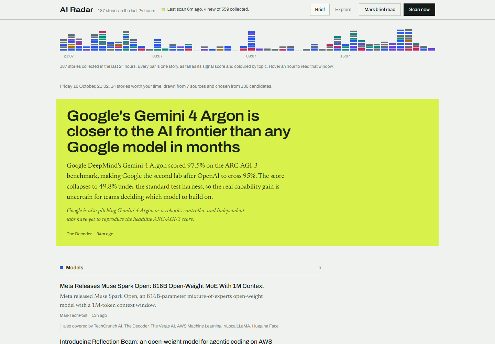

# AI Radar

A personal, local-only news radar for the AI and startup ecosystem — model
launches, funding, APIs, agents, research, and the industry shifting around
them.

It does two things:

- **Brief** — a daily curated digest. A local OpenCode agent reads the day's
  headlines and writes one ranked brief: a single lead story, themed sections,
  and a short "watching" list.
- **Explore** — everything Radar collected, filterable by topic, source,
  search, unread, and saved.

Radar refreshes itself roughly once an hour and can be triggered by hand.
Nothing leaves your machine except the outbound feed fetches and the curation
call to your local OpenCode service.

> **Want the full picture first?** Open [`how-it-works.html`](how-it-works.html)
> in a browser — a self-contained explainer of every stage, the source list, and
> the decisions (and dead ends) behind the design.



---

## Requirements

- **Node.js 24 or newer.** Radar uses the built-in `node:sqlite` module, which
  does not exist in earlier versions. Check with `node -v`.
- **OpenCode**, installed and signed in, with at least one working model. Radar
  talks to the OpenCode background service — it does not call any cloud API
  directly.
- **Git**, only if you are cloning rather than copying the folder.

Two runtime dependencies are installed for you: `@opencode/client` (to reach the
local OpenCode service) and `fast-xml-parser` (to read feeds). There is no build
step — the frontend is plain HTML, CSS and JS.

---

## Installation

### 1. Get the code

```bash
git clone https://github.com/mirza7860/news-radar.git
cd news-radar
```

Or simply copy the folder anywhere. There is no build step, and nothing depends
on an absolute path outside the project directory.

### 2. Install dependencies

```bash
npm install
```

That is the only setup command.

### 3. Make sure OpenCode is available

Radar borrows your local OpenCode service to write the brief, so the service
must be installed and authenticated:

```bash
opencode --version
```

If you have never used OpenCode on this machine, start it once and sign in so it
has at least one usable model. Radar discovers the service on its own
(`Service.ensure()`) — you do not have to keep a terminal open for it, but it
does need to be installed and signed in.

### 4. Start Radar

```bash
npm start
```

You should see:

```
  AI Radar  ·  http://127.0.0.1:4310
  36 sources · refresh every 60m · model opencode/deepseek-v4.1-flash-free
```

### 5. Open it

Visit <http://127.0.0.1:4310>.

The **first run has nothing stored yet**, so Radar immediately collects from all
36 feeds and asks the curator for a brief. That first scan takes roughly a
minute — collection is fast, the model call is the slow part. The header shows
live progress while it works, then the brief appears.

After that Radar refreshes itself every 60 minutes, and **Scan now** in the
header triggers one by hand.

### 6. (Optional) Check it without the UI

```bash
npm run scan             # one scan, printing each pipeline step
npm run verify-sources   # probe all 36 feeds and report which ones work
```

---

## Running it in the background

`npm start` runs in the foreground of whatever terminal launched it. **Closing
that terminal — or restarting your computer — stops Radar.** Nothing is
registered as a service or startup entry by default.

Two ways to make it survive a restart.

### Windows — register a scheduled task (one command)

A logon-triggered scheduled task starts Radar whenever you sign in. Paste this
into PowerShell; it needs no admin rights and is re-runnable (it overwrites):

```powershell
$proj = (Get-Location).Path                       # run this from the repo root
$node = (Get-Command node).Source
$user = "$env:USERDOMAIN\$env:USERNAME"

Register-ScheduledTask -TaskName "AI Radar" -Force `
  -Action    (New-ScheduledTaskAction -Execute $node -Argument "server\index.js" -WorkingDirectory $proj) `
  -Trigger   (New-ScheduledTaskTrigger -AtLogOn -User $user) `
  -Principal (New-ScheduledTaskPrincipal -UserId $user -LogonType Interactive -RunLevel Limited) `
  -Settings  (New-ScheduledTaskSettingsSet -AllowStartIfOnBatteries -DontStopIfGoingOnBatteries `
                -ExecutionTimeLimit (New-TimeSpan -Seconds 0) -MultipleInstances IgnoreNew -StartWhenAvailable) `
  -Description "Starts the local AI Radar news server (node server/index.js) at logon."
```

The two settings that matter are `-ExecutionTimeLimit (New-TimeSpan -Seconds 0)`
(no time limit — Radar is a long-running server) and `-MultipleInstances
IgnoreNew` (never start a second copy while one is already up).

Test it immediately without logging out:

```powershell
Start-ScheduledTask  -TaskName "AI Radar"    # starts it now
Get-ScheduledTaskInfo -TaskName "AI Radar"   # expect LastTaskResult 267009 while running
```

Remove it again with:

```powershell
Unregister-ScheduledTask -TaskName "AI Radar" -Confirm:$false
```

> Note: `LastTaskResult` reports `267009` (`0x41301`) while a task is running —
> that is success, not an error code.

### macOS / Linux

A `launchd` agent or a systemd user unit pointing at `node server/index.js` with
the working directory set to the repo.

### Or just keep a terminal open

The least setup of all, and entirely fine if you only use Radar while you are at
the machine.

In all cases, **OpenCode must be available for the curation step.** Radar's
client discovers and starts the OpenCode service if it is not already running,
but the service has to be installed and signed in. If it is unreachable when a
scan fires, the headlines are still collected and stored — you just get the
"curator didn't answer" state until a model responds again.

---

## Publishing a read-only mirror to GitHub Pages

GitHub Pages serves files. It has no Node runtime, no SQLite, and no model, so
**the radar server itself cannot run there** — what gets published is a static
mirror of it. That mirror is genuinely useful: everything except the brief is
rebuilt from live feeds every hour.

`.github/workflows/deploy-pages.yml` runs on every push, on demand, and hourly
at :17. Each run:

1. `npm ci`
2. `npm run scan` with `RADAR_NO_CURATE=1` — collects and scores every feed,
   skipping only the model call
3. `npm run export` — bakes the API responses to JSON in `dist/`
4. uploads `dist/` and deploys it to Pages

### One-time setup

Pages has to be pointed at the workflow once; this is a repository setting, and
the workflow's token is not allowed to change it:

**Settings → Pages → Build and deployment → Source: GitHub Actions.**

Then push, or run the workflow from the **Actions** tab. The URL is
`https://<user>.github.io/news-radar/`.

### What updates, and what doesn't

| Part of the page | In the mirror |
| --- | --- |
| Headlines, Explore, search, topic and source filters | **Rebuilt every hour** from live feeds |
| The 24-hour strip and its tooltip | **Rebuilt every hour** |
| Source health, item counts, stats | **Rebuilt every hour** |
| Mark read / save / Scan now / curator model | **Removed** — a static page cannot write |
| The brief | **Carried over** from `snapshot/brief.json` |

The brief is the only part that needs a language model. To give the public site
a fresh brief, curate locally and publish the result:

```bash
npm start                          # let a scan finish and write a brief
npm run snapshot-brief             # copies that brief into snapshot/brief.json
git add snapshot/brief.json && git commit -m "brief: refresh" && git push
```

`npm run export` prefers a real brief in the local database and falls back to
the snapshot, so running it locally gives you a preview of exactly what Pages
will serve. `dist/` is a throwaway build directory and is git-ignored.

Two things worth knowing about the scheduled run: GitHub disables cron
workflows after 60 days without repository activity, and a scheduled run can
start several minutes late when the queue is busy.

### If you want the *live* app on the internet

The mirror is read-only by construction. To run the real thing with its own
hourly scans and live briefs, it needs a host with a running Node process and a
persistent disk — Render, Fly.io, Railway, or a small VPS — plus a reachable
model. Keep it private: the server binds to `127.0.0.1` by default and has no
authentication.

---

## Troubleshooting

| Symptom | Cause and fix |
| --- | --- |
| `node:sqlite` not found, or a parse error on `with { type: 'json' }` | Node is older than 24. Check `node -v` and upgrade. |
| The brief says *"The curator didn't answer"* | Headlines were still collected and stored, so nothing is lost. Usually the model is unreachable — confirm OpenCode is running and that the model named in `radar.config.json` still exists. The exact error is shown on the page. |
| *"OpenCode's free tier can only be used from within OpenCode…"* | A free `opencode/*` model was rejected. Radar already runs those in *plain* mode; seeing this means the provider id changed or a different provider needs `mode` forced. See **Choosing a curator model**. |
| Port 4310 already in use | Change `port` in `radar.config.json`, or free it: `Get-NetTCPConnection -LocalPort 4310 -State Listen` then `Stop-Process -Id <pid> -Force`. |
| A source stopped appearing | Run `npm run verify-sources`. Radar tracks per-feed status in the `source_health` table and drops a broken feed without failing the whole scan. |
| Explore looks empty while a brief exists | Explore defaults to recent items and the filters may be left on. Clear the search box and the topic chips. |
| Everything looks stale | Read the header status line. If a scan is running, wait — the model call alone takes 40–60 seconds. |
| The Pages workflow fails at *Configure Pages* | Pages is not enabled, or its source is not set to *GitHub Actions*. See the Pages section above. |
| The published mirror shows an old brief | Expected — a runner has no model. Refresh `snapshot/brief.json` and push. |

---

## How it works

Radar deliberately keeps the language model out of the fetching path. The
pipeline is:

```
36 RSS/Atom feeds
      │  collect.js      fetch + parse in parallel (6 at a time)
      ▼
  raw items
      │  text.js         strip HTML, clean summaries, decode entities
      │  rank.js         classify topics, score signal, collapse duplicates
      ▼
  ranked candidates  ──────────►  SQLite (data/radar.db)
      │
      │  curate.js       one OpenCode call: text in, strict JSON out
      ▼
  the brief           ──────────►  SQLite + the Brief view
```

Why this shape:

- **Collection is deterministic.** Fetching and parsing feeds is fast, free, and
  reliable. A model doing it would be slower, costlier, and non-reproducible.
- **The model only curates.** It receives a numbered list of candidates and
  returns JSON. That is the one step where judgement actually helps.
- **Item numbers are always resolved back to real records.** If the model
  misaligns a note with an item, the UI still shows the correct story — the note
  may be off, but nothing is fabricated or mismatched.

### Scoring and topics

`rank.js` scores every item 0–100 from recency tiers, source weight, and
keyword signal rules (money figures, funding verbs, launches, open-source,
APIs, benchmarks, agents) minus noise rules (opinion, podcasts, roundups,
tutorials, sponsored posts). Topics are keyword matches across `models`,
`funding`, `agents`, `platforms`, `research`, and `industry`. Duplicate stories
syndicated across outlets are collapsed with a token-overlap similarity check,
and the extra outlets are kept as "also covered by".

---

## Configuration

Everything lives in `radar.config.json` at the repo root. Edit it and restart,
or change the model from the **model** button in the UI (which rewrites this
file).

```jsonc
{
  "model": { "providerID": "opencode", "id": "deepseek-v4.1-flash-free", "variant": null },
  "refreshMinutes": 60,        // how often the scheduler scans
  "autoScanOnBoot": true,      // scan on start if a scan is nearly due
  "port": 4310,
  "collection": {
    "windowHours": 48,         // only items this recent become candidates
    "maxCandidates": 130,      // cap sent to the curator
    "summaryChars": 340,       // summary length stored per item
    "maxPerSource": 25,        // max entries taken per feed
    "concurrency": 6,          // feeds fetched in parallel
    "feedTimeoutMs": 15000
  },
  "curator": { "enabled": true, "timeoutMs": 300000 }
}
```

Set `curator.enabled` to `false` to collect and browse without ever calling a
model — useful for testing feeds.

---

## Choosing a curator model

Radar runs the curator through the OpenCode client. The provider matters,
because of one hard rule:

> **Free `opencode/*` models can only be used from a "clean" session.** If the
> session carries a custom system prompt, a `permissions` override, or a named
> agent with a body, the call is rejected with
> *"OpenCode's free tier can only be used from within OpenCode…"*.

So `curate.js` picks one of two modes automatically:

| Provider          | Mode     | What the session looks like                                            |
| ----------------- | -------- | ---------------------------------------------------------------------- |
| `opencode`        | `plain`  | No agent, no permissions. Curator instructions are prepended inline.   |
| anything else     | `locked` | Session uses the `radar` agent and a deny-all permission set.          |

The curator instructions themselves are the single source of truth in
`.opencode/agents/radar.md`.

**Defaults and known-good options**

- `opencode/deepseek-v4.1-flash-free` — default. Free, plain mode, and the best
  curator we tested (good coverage, specific numbers, correct lead).
- `nvidia/nvidia/nemotron-3.5-super-vl-120b-a12b` — free, locked mode. Works,
  but weaker: it occasionally attaches a note to the wrong item.

`npm run compare-models` runs both against the real candidate set already in the
database and prints the briefs side by side.

---

## Sources

36 feeds, verified working, grouped by category. Edit `DEFAULT_SOURCES` in
`server/config.js` to change them. Each source may carry a `weight` (added to
its items' scores) and an optional `limit`.

- **labs** — OpenAI, Google DeepMind, Hugging Face, Mistral AI, NVIDIA, AWS ML
- **press** — TechCrunch AI, The Verge AI, Ars Technica, Techmeme, The Decoder,
  MIT Technology Review, IEEE Spectrum AI, MarkTechPost
- **practitioners** — Simon Willison, Interconnects, Import AI, Latent Space,
  Ahead of AI, One Useful Thing, Stratechery
- **releases** — GitHub, plus releases feeds for vLLM, transformers,
  llama.cpp, the Vercel AI SDK, LangChain, and openai-python
- **community** — Hacker News (front page and LLM search), r/LocalLLaMA
- **funding** — Crunchbase News
- **research** — arXiv cs.AI, arXiv cs.LG
- **search** — Google News for "artificial intelligence" and "Anthropic"

Check them any time:

```bash
npm run verify-sources                 # all feeds
npm run verify-sources -- research     # only feeds whose id/category matches
```

---

## Maintenance scripts

| Script                    | What it does                                                             |
| ------------------------- | ------------------------------------------------------------------------ |
| `npm start`               | Run the server (auto-scans, hourly scheduler, SSE live status).          |
| `npm run scan`            | Run one scan in the terminal, printing each pipeline step.               |
| `npm run reclassify`      | Re-run topic classification, scoring, and summary cleaning over the whole store. Use after editing topics, keywords, or the mute list. |
| `npm run verify-sources`  | Probe every feed and report which ones work.                             |
| `npm run compare-models`  | A/B the candidate curator models on real data.                           |
| `npm run snapshot-brief`  | Copy the current brief into `snapshot/brief.json` for the Pages build.   |
| `npm run export`          | Build the static mirror into `dist/`.                                    |

The server also repairs stored rows on every scan (classification, scores, and
summaries are rewritten), so collector changes self-heal over the collection
window. `reclassify` does the same across *every* stored item at once.

---

## HTTP API

The frontend is a thin client over a small JSON API:

| Method & path            | Purpose                                                        |
| ------------------------ | -------------------------------------------------------------- |
| `GET /api/bootstrap`     | Everything the app needs on load: brief, sources, topics, stats, timeline, config. |
| `GET /api/timeline?hours=24` | The 24-hour bar-strip data (48 buckets).                   |
| `GET /api/items`         | Explore items. Query: `topic, source, q, hours, saved, unread, limit, offset`. |
| `GET /api/briefs`        | The 40 most recent briefs.                                     |
| `POST /api/scan`         | Trigger a scan. Returns `202` immediately; progress streams over SSE. |
| `POST /api/items/read`   | Mark a batch read. Body `{ "ids": [...] }`.                    |
| `POST /api/items/:id`    | Set one item's state. Body `{ "read"?: bool, "saved"?: bool }`. |
| `POST /api/config`       | Update the curator model and settings.                         |
| `POST /api/maintenance/prune` | Run the history-prune pass on demand.                     |
| `GET /api/events`        | Server-sent events: live scan status.                          |

---

## Storage

A single SQLite file at `data/radar.db` with four tables: `items`, `briefs`,
`scans`, and `source_health`. History is pruned on a schedule (items older than
60 days, briefs older than 90 days). Delete the file to start over — it will be
recreated on the next scan.

---

## Design notes

The visual identity is deliberate and worth preserving if you extend the UI:

- Cool pale green-grey "paper" background with near-black green ink, and a
  single chartreuse highlighter used **only** for the day's lead block and the
  live-status dot.
- Topic colours are functional data colours, shared by the 24-hour strip, the
  section swatches, and the Explore chips — not decoration.
- Type: Archivo (with its variable width axis) for display and UI, Newsreader
  (serif) for prose.
- No border-radius, no cards, no ALL-CAPS eyebrow labels, no numbered markers.
- Dark mode follows `prefers-color-scheme`.
- One orchestrated motion: the strip bars rise with a 13 ms-per-slot stagger.
